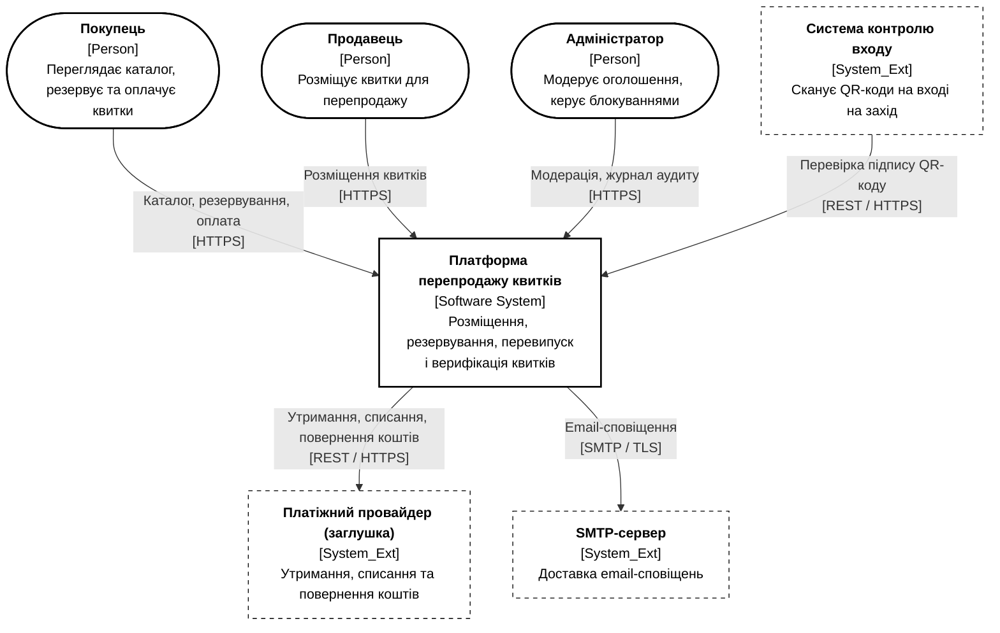
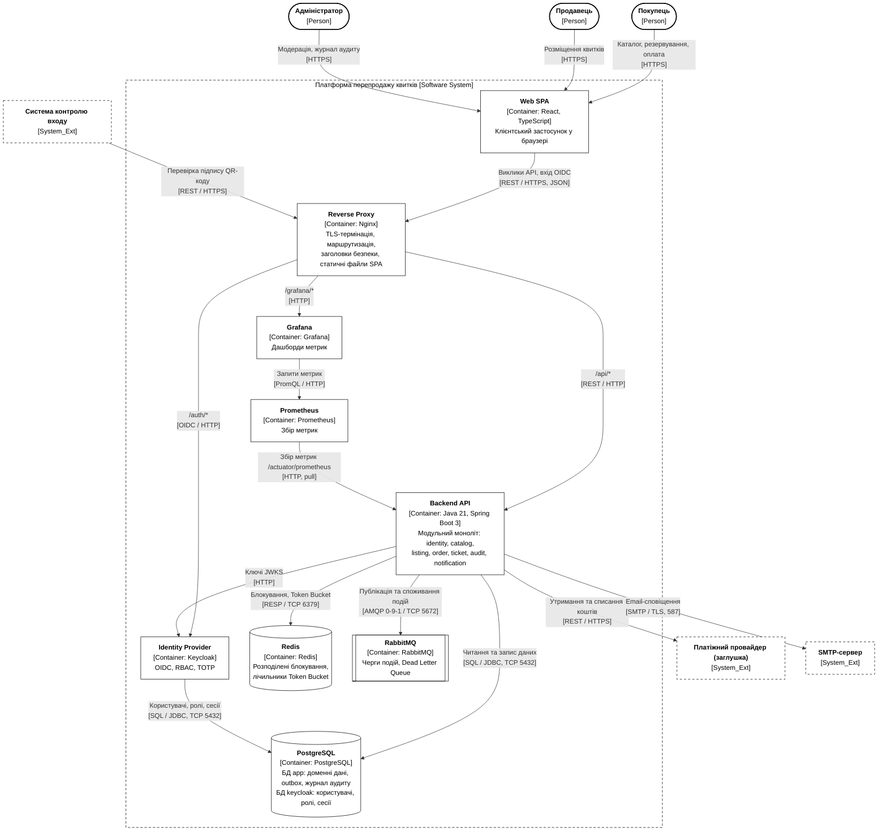

# РОЗДІЛ 2. ПРОЄКТУВАННЯ СИСТЕМИ

Вимоги до системи наведено у [специфікації вимог (SRS)](srs.md); архітектурні рішення зафіксовано в каталозі [adr/](adr/).

## 2.1 Контекстне та контейнерне моделювання системи (C4 Model)

### 2.1.1 Діаграма рівня 1 (System Context)

**Опис діаграми.** Платформа перепродажу квитків розглядається як єдина програмна система, межі якої визначено в [SRS, розділ 1.1](srs.md#11-призначення-та-межі-системи-scope).

| Елемент | Тип | Взаємодія | Протокол | Вимоги |
|---|---|---|---|---|
| Покупець | Person | Перегляд каталогу, резервування, оплата | HTTPS | [SRS-FUN-08](srs.md#srs-fun-08), [SRS-FUN-13](srs.md#srs-fun-13), [SRS-FUN-17](srs.md#srs-fun-17) |
| Продавець | Person | Розміщення квитків | HTTPS | [SRS-FUN-03](srs.md#srs-fun-03), [SRS-FUN-09](srs.md#srs-fun-09), [SRS-FUN-11](srs.md#srs-fun-11) |
| Адміністратор | Person | Модерація оголошень, керування блокуваннями, журнал аудиту | HTTPS | [SRS-FUN-07](srs.md#srs-fun-07), [SRS-FUN-12](srs.md#srs-fun-12), [SRS-FUN-22](srs.md#srs-fun-22) |
| Система контролю входу | System_Ext | Перевірка підпису QR-коду | REST / HTTPS | [SRS-FUN-20](srs.md#srs-fun-20) |
| Платіжний провайдер (заглушка) | System_Ext | Утримання, списання та повернення коштів | REST / HTTPS | [SRS-FUN-17](srs.md#srs-fun-17), [SRS-NFR-CMP-02](srs.md#srs-nfr-cmp-02) |
| SMTP-сервер | System_Ext | Доставка email-сповіщень | SMTP / TLS | [SRS-FUN-23](srs.md#srs-fun-23), [SRS-FUN-24](srs.md#srs-fun-24) |

### 2.1.2 Діаграма рівня 2 (Container)

**Опис контейнерів.**

| Контейнер | Технологія | Відповідальність | Трасування |
|---|---|---|---|
| Web SPA | React, TypeScript | Інтерфейс покупця, продавця та адміністратора; отримання токенів за OIDC Authorization Code Flow з PKCE | [SRS-FUN-01](srs.md#srs-fun-01), [SRS-NFR-SEC-01](srs.md#srs-nfr-sec-01) |
| Reverse Proxy | Nginx | TLS-термінація, маршрутизація запитів, заголовки безпеки, видача статичних файлів SPA | [SRS-NFR-SEC-04](srs.md#srs-nfr-sec-04), [SRS-NFR-SEC-12](srs.md#srs-nfr-sec-12) |
| Backend API | Java 21, Spring Boot 3 | Модульний моноліт: модулі `identity`, `catalog`, `listing`, `order`, `ticket`, `audit`, `notification`; Transactional Outbox і споживачі подій | [SRS-FUN-02](srs.md#srs-fun-02) – [SRS-FUN-25](srs.md#srs-fun-25) |
| Identity Provider | Keycloak | Автентифікація OIDC, ролі RBAC, TOTP для ролі SELLER, видача JWT (RS256) | [SRS-FUN-01](srs.md#srs-fun-01), [SRS-FUN-03](srs.md#srs-fun-03), [SRS-NFR-SEC-02](srs.md#srs-nfr-sec-02), [SRS-NFR-SEC-03](srs.md#srs-nfr-sec-03) |
| PostgreSQL | PostgreSQL | БД `app`: доменні дані, таблиця outbox, append-only журнал аудиту; БД `keycloak` | [SRS-FUN-22](srs.md#srs-fun-22), [SRS-NFR-CMP-03](srs.md#srs-nfr-cmp-03), [SRS-NFR-REL-04](srs.md#srs-nfr-rel-04) |
| Redis | Redis | Розподілені блокування резервів (TTL), лічильники Token Bucket | [SRS-FUN-04](srs.md#srs-fun-04), [SRS-FUN-05](srs.md#srs-fun-05), [SRS-FUN-13](srs.md#srs-fun-13), [SRS-NFR-INT-02](srs.md#srs-nfr-int-02) |
| RabbitMQ | RabbitMQ | Черги подій модулів `audit` і `notification`, Dead Letter Queue | [SRS-FUN-21](srs.md#srs-fun-21), [SRS-NFR-REL-01](srs.md#srs-nfr-rel-01), [SRS-NFR-REL-02](srs.md#srs-nfr-rel-02); рішення [ADR-001](adr/0001-choice-of-technology.md) |
| Prometheus | Prometheus | Збір метрик Spring Boot Actuator з інтервалом 15 с | [SRS-NFR-OBS-01](srs.md#srs-nfr-obs-01) |
| Grafana | Grafana | Дашборди латентності p95, частки HTTP 429 і 5xx | [SRS-NFR-OBS-01](srs.md#srs-nfr-obs-01) |

**Протоколи взаємодії.**

| Зв'язок | Протокол | Призначення |
|---|---|---|
| Користувач → Web SPA | HTTPS | Завантаження клієнтського застосунку |
| Web SPA → Reverse Proxy | REST / HTTPS (JSON) | Виклики API та вхід за OIDC |
| Система контролю входу → Reverse Proxy | REST / HTTPS | Перевірка підпису QR-коду |
| Reverse Proxy → Backend API | REST / HTTP | Маршрут `/api/*` у внутрішній мережі Docker |
| Reverse Proxy → Identity Provider | OIDC / HTTP | Маршрут `/auth/*` |
| Reverse Proxy → Grafana | HTTP | Маршрут `/grafana/*` (доступ для ролі ADMIN) |
| Backend API → Identity Provider | HTTP | Отримання відкритих ключів JWKS для перевірки підпису JWT |
| Backend API, Identity Provider → PostgreSQL | SQL / JDBC (TCP 5432) | Читання та запис даних |
| Backend API → Redis | RESP / TCP 6379 | Операції `SET NX PX`, лічильники Token Bucket |
| Backend API → RabbitMQ | AMQP 0-9-1 / TCP 5672 | Публікація подій з outbox і споживання подій |
| Backend API → Платіжний провайдер | REST / HTTPS | Утримання, списання, повернення коштів |
| Backend API → SMTP-сервер | SMTP / TLS (587) | Email-сповіщення |
| Prometheus → Backend API | HTTP (pull) | Збір метрик `/actuator/prometheus` |
| Grafana → Prometheus | PromQL / HTTP | Запити метрик для дашбордів |

Контейнер Backend API реалізує вимоги безпеки [SRS-FUN-02](srs.md#srs-fun-02) та [SRS-FUN-04](srs.md#srs-fun-04) на рівні фільтрів запиту (див. [діаграму рівня 3](#diagram-level3)), а асинхронна взаємодія модулів базується на рішенні [ADR-001](adr/0001-choice-of-technology.md) щодо використання RabbitMQ.

## 2.2 Компонентне моделювання критичного сервісу системи

### 2.2.1 Діаграма рівня 3 (Component): Backend API, модуль `order`

Для декомпозиції обрано модуль `order` контейнера [Backend API](#diagram-level2): він містить логіку резервування в умовах конкурентного доступу, скінченний автомат станів замовлення та публікацію подій через Transactional Outbox.

```mermaid
flowchart TB
    proxy["<b>Reverse Proxy</b><br/>[Container: Nginx]"]

    subgraph apiB["Backend API [Container: Java 21, Spring Boot 3] — модуль order"]
        subgraph inbound["Вхідний шар (Inbound)"]
            rl["<b>RateLimitFilter</b><br/>[Component: Servlet Filter, Bucket4j]<br/>Token Bucket за IP та обліковим записом"]
            sec["<b>SecurityFilterChain</b><br/>[Component: Spring Security,<br/>OAuth2 Resource Server]<br/>Верифікація JWT, RBAC"]
            ctrl["<b>OrderController</b><br/>[Component: @RestController]<br/>Резервування, оплата, скасування"]
            val["<b>DTO Validation</b><br/>[Component: Jakarta Bean Validation]<br/>Валідація вхідних DTO"]
            err["<b>GlobalExceptionHandler</b><br/>[Component: @RestControllerAdvice]<br/>Problem Details (RFC 9457)"]
        end
        subgraph core["Шар бізнес-логіки (Core)"]
            rsv["<b>ReservationService</b><br/>[Component: @Service]<br/>Резервування, квота, звільнення резерву"]
            ord["<b>OrderService</b><br/>[Component: @Service]<br/>Оплата, переходи станів, перевипуск"]
            dom["<b>Order Domain</b><br/>[Component: OrderStateMachine, QuotaPolicy]<br/>Дозволені переходи станів, квота"]
            job["<b>ReservationExpiryJob</b><br/>[Component: @Scheduled]<br/>Звільнення прострочених резервів"]
            ticket["<b>TicketReissueFacade</b><br/>[Component: модуль ticket, JCA ECDSA]<br/>Анулювання і перевипуск QR-коду"]
        end
        subgraph outbound["Шар інфраструктури (Outbound)"]
            lock["<b>RedisReservationLockAdapter</b><br/>[Component: Spring Data Redis]<br/>Реалізує ReservationLockPort"]
            repo["<b>OrderRepository</b><br/>[Component: Spring Data JPA]<br/>Оптимістичне блокування @Version"]
            outbox["<b>OutboxWriter</b><br/>[Component: Spring Data JPA]<br/>Реалізує DomainEventPublisher"]
            relay["<b>OutboxRelay</b><br/>[Component: @Scheduled, Spring AMQP]<br/>Публікація подій з outbox"]
            payc["<b>PaymentGatewayClient</b><br/>[Component: Spring RestClient]<br/>Реалізує PaymentGatewayPort"]
            obs["<b>Observability</b><br/>[Component: Micrometer, Logback JSON]<br/>Метрики, логи з correlation ID"]
        end
    end

    db[("<b>PostgreSQL</b><br/>[Container]")]
    redis[("<b>Redis</b><br/>[Container]")]
    mq[["<b>RabbitMQ</b><br/>[Container]"]]
    pay["<b>Платіжний провайдер (заглушка)</b><br/>[System_Ext]"]
    prom["<b>Prometheus</b><br/>[Container]"]

    proxy -- "HTTP-запит<br/>[REST / HTTP]" --> rl
    rl -- "Servlet Filter Chain" --> sec
    sec -- "Автентифікований запит<br/>[Spring MVC dispatch]" --> ctrl
    ctrl -- "@Valid" --> val
    ctrl -. "Винятки<br/>[@ExceptionHandler]" .-> err
    ctrl -- "Резервування<br/>[інтерфейс, DI]" --> rsv
    ctrl -- "Оплата, скасування<br/>[інтерфейс, DI]" --> ord
    job -- "Звільнення резервів<br/>[інтерфейс, DI]" --> rsv
    rsv -- "Перевірка квоти" --> dom
    ord -- "Перехід стану" --> dom
    ord -- "Перевипуск квитка<br/>[TicketReissueApi, DI]" --> ticket
    rsv -- "Блокування оголошення<br/>[ReservationLockPort, DI]" --> lock
    rsv -- "Збереження резерву<br/>[OrderRepository, DI]" --> repo
    ord -- "Збереження замовлення<br/>[OrderRepository, DI]" --> repo
    ord -- "Подія зміни стану<br/>[DomainEventPublisher, DI]" --> outbox
    ord -- "Утримання, списання коштів<br/>[PaymentGatewayPort, DI]" --> payc
    lock -- "SET NX PX, DEL<br/>[RESP / TCP 6379]" --> redis
    repo -- "SQL<br/>[JDBC / TCP 5432]" --> db
    outbox -- "INSERT outbox<br/>[JDBC / TCP 5432]" --> db
    relay -- "Вибірка непублікованих подій<br/>[JDBC / TCP 5432]" --> db
    relay -- "Публікація подій<br/>[AMQP 0-9-1 / TCP 5672]" --> mq
    payc -- "Платіжне API<br/>[REST / HTTPS]" --> pay
    prom -- "/actuator/prometheus<br/>[HTTP, pull]" --> obs

    classDef person fill:#ffffff,stroke:#000000,stroke-width:2px,color:#000000
    classDef system fill:#ffffff,stroke:#000000,stroke-width:2px,color:#000000
    classDef container fill:#ffffff,stroke:#000000,stroke-width:1px,color:#000000
    classDef ext fill:#ffffff,stroke:#000000,stroke-width:1px,stroke-dasharray:5 5,color:#000000
    class rl,sec,ctrl,val,err,rsv,ord,dom,job,ticket,lock,repo,outbox,relay,payc,obs container
    class proxy,db,redis,mq,prom container
    class pay ext
    style apiB fill:#ffffff,stroke:#000000,stroke-dasharray:6 4,color:#000000
    style inbound fill:#ffffff,stroke:#666666,color:#000000
    style core fill:#ffffff,stroke:#666666,color:#000000
    style outbound fill:#ffffff,stroke:#666666,color:#000000
```

### 2.2.2 Опис компонентів

**Вхідний шар (Inbound).**

| Компонент | Технологія | Роль | Трасування |
|---|---|---|---|
| RateLimitFilter | Servlet Filter, Bucket4j (Redis) | Обмеження частоти запитів за IP-адресою та обліковим записом; повертає HTTP 429 з Retry-After до виконання бізнес-логіки | [SRS-FUN-04](srs.md#srs-fun-04), [SRS-FUN-05](srs.md#srs-fun-05), [SRS-NFR-SEC-05](srs.md#srs-nfr-sec-05), [SRS-NFR-SEC-06](srs.md#srs-nfr-sec-06) |
| SecurityFilterChain | Spring Security, OAuth2 Resource Server | Перевірка підпису та строку дії JWT за ключами JWKS, перевірка ролей | [SRS-FUN-02](srs.md#srs-fun-02), [SRS-NFR-SEC-02](srs.md#srs-nfr-sec-02) |
| OrderController | Spring MVC `@RestController` | Приймає REST-запити, перетворює DTO на команди, делегує сервісам; не має прямого доступу до репозиторіїв | [SRS-FUN-13](srs.md#srs-fun-13), [SRS-FUN-16](srs.md#srs-fun-16) |
| DTO Validation | Jakarta Bean Validation | Валідація вхідних DTO анотацією `@Valid` до виклику сервісів | [SRS-NFR-SEC-10](srs.md#srs-nfr-sec-10) |
| GlobalExceptionHandler | `@RestControllerAdvice` | Перетворює доменні винятки на відповіді Problem Details (RFC 9457): 409 — конфлікт резерву, 422 — перевищення квоти, 403 — відмова в доступі | [SRS-FUN-10](srs.md#srs-fun-10), [SRS-FUN-14](srs.md#srs-fun-14) |

**Шар бізнес-логіки (Core).**

| Компонент | Технологія | Роль | Трасування |
|---|---|---|---|
| ReservationService | Spring `@Service` | Перевіряє квоту, встановлює блокування через `ReservationLockPort`, створює резерв | [SRS-FUN-13](srs.md#srs-fun-13), [SRS-FUN-14](srs.md#srs-fun-14), [SRS-NFR-INT-01](srs.md#srs-nfr-int-01) |
| OrderService | Spring `@Service` | Керує оплатою через `PaymentGatewayPort`, переходами станів і перевипуском квитка; публікує події через `DomainEventPublisher` | [SRS-FUN-16](srs.md#srs-fun-16), [SRS-FUN-17](srs.md#srs-fun-17), [SRS-FUN-21](srs.md#srs-fun-21) |
| Order Domain | `OrderStateMachine`, `QuotaPolicy` | Доменні правила без залежностей від фреймворку: дозволені переходи станів, квота на подію | [SRS-FUN-16](srs.md#srs-fun-16), [SRS-NFR-SEC-07](srs.md#srs-nfr-sec-07) |
| ReservationExpiryJob | Spring `@Scheduled` | Щохвилинно звільняє резерви з вичерпаним TTL | [SRS-FUN-15](srs.md#srs-fun-15), [SRS-NFR-INT-02](srs.md#srs-nfr-int-02) |
| TicketReissueFacade | Модуль `ticket`, Java Cryptography Architecture | Анулює попередній QR-код і формує новий з підписом ECDSA; викликається через інтерфейс `TicketReissueApi` | [SRS-FUN-18](srs.md#srs-fun-18), [SRS-FUN-19](srs.md#srs-fun-19), [SRS-NFR-SEC-09](srs.md#srs-nfr-sec-09) |

**Шар інфраструктури (Outbound).**

| Компонент | Технологія | Роль | Трасування |
|---|---|---|---|
| RedisReservationLockAdapter | Spring Data Redis | Реалізує `ReservationLockPort`: атомарна операція `SET NX PX` з TTL | [SRS-FUN-13](srs.md#srs-fun-13), [SRS-NFR-REL-03](srs.md#srs-nfr-rel-03) |
| OrderRepository | Spring Data JPA | Збереження замовлень з оптимістичним блокуванням (`@Version`) — другий рівень захисту від подвійного продажу | [SRS-NFR-INT-01](srs.md#srs-nfr-int-01), [SRS-NFR-REL-03](srs.md#srs-nfr-rel-03) |
| OutboxWriter | Spring Data JPA | Реалізує `DomainEventPublisher`: записує подію в таблицю outbox у транзакції зміни стану | [SRS-FUN-21](srs.md#srs-fun-21) |
| OutboxRelay | Spring `@Scheduled`, Spring AMQP | Вибирає непубліковані події з outbox і публікує їх у RabbitMQ з інтервалом ≤ 1 с | [SRS-NFR-REL-01](srs.md#srs-nfr-rel-01); рішення [ADR-001](adr/0001-choice-of-technology.md) |
| PaymentGatewayClient | Spring RestClient | Реалізує `PaymentGatewayPort` для платіжного провайдера (заглушки) | [SRS-FUN-17](srs.md#srs-fun-17), [SRS-NFR-CMP-02](srs.md#srs-nfr-cmp-02) |
| Observability | Micrometer, Logback (JSON) | Метрики для Prometheus, структуровані логи з correlation ID | [SRS-NFR-OBS-01](srs.md#srs-nfr-obs-01), [SRS-NFR-OBS-02](srs.md#srs-nfr-obs-02) |

**Принципи взаємодії компонентів.** Залежності спрямовані від вхідного шару до доменного ядра: сервіси бізнес-логіки залежать від інтерфейсів (`ReservationLockPort`, `PaymentGatewayPort`, `DomainEventPublisher`, `TicketReissueApi`), а їхні реалізації впроваджуються контейнером Spring через Dependency Injection (принцип інверсії залежностей). Контролер не має прямого доступу до репозиторіїв. Подія зміни стану записується в outbox у тій самій транзакції, що й замовлення, тому відсутній подвійний запис (dual write) у БД і брокер.

## 2.3 Документування архітектурних рішень (Architecture Decision Records)

| ID | Рішення | Статус |
|---|---|---|
| [ADR-001](adr/0001-choice-of-technology.md) | Вибір брокера повідомлень для подієвої взаємодії модулів: RabbitMQ | Approved |
